

<nav class="report-toc" aria-label="Contents">

Contents

<ul>
  <li><a href="#velocity">Work at a glance</a></li>
  <li><a href="#words">Words used here</a></li>
  <li><a href="#stage-1">1. My agent and me</a></li>
  <li><a href="#stage-2">2. The agent runs the game</a></li>
  <li><a href="#stage-3">3. One agent, with beads</a></li>
  <li><a href="#stage-4">4. Parallel lanes</a></li>
  <li><a href="#stage-5">5. Okay but now let's do it better</a></li>
  <li><a href="#stage-6">6. The factory</a></li>
  <li><a href="#lessons">What bought the velocity</a></li>
</ul>
</nav>

Okonomiyaki · written 2026-11-21 from <code>git log</code> (3,746 commits), the beads database (3,312 beads) and <code>docs/beads/metrics/events.jsonl</code> (14,305 dispatch events). Drafted by Claude Opus 5.5, then heckled by me.

In March, I decided I wanted to build my dream game. I already had a handcrafted version from following the excellent <a href="https://www.udemy.com/course/create-a-complete-2d-arena-survival-roguelike-game-in-godot-4/">Godot Course</a>. That foundation was super helpful for me to understand how making a game in Godot should generally feel and what makes a game feel good!

Right around that time, agent CLIs like Claude and Codex became popular, so I decided to try building the game with agents. My early asks of the agents were very conservative and I landed about three commits a week. I didn't know how much to trust or how to really use agents productively yet. I asked ChatGPT for sprites, but still needed to clean them up manually. Early agent-generated art was a colored rectangle, with ambition. I kept at it for many more months; adding more features while refining my workflows.

By November my workflow had expanded significantly: five agent lanes (briefly eight, until my CPU objected) can work in parts of the codebase in parallel collision-free (mostly), a reviewer keeps the code quality and correctness in check so that I don't spaghetti, and two art and sound studios delegate asset generation to remote and local LLMs. In one week in November, it closed 931 beads and landed 1,334 commits.

What emerged from this year was a software factory, probably. I'm not sure how cohesive that definition is yet. This post talks about how I went from a single agent slowly building simple ideas to a fully orchestrated system where I come up with the ideas, decide on details (decision beads) and ultimately find the fun.

  

3,746

commits since 2026-03-28

  

3,312

beads filed since 2026-08-19 (3,227 closed)

  

678

decision beads answered by the lead

  

59 → 3,191

<code>.gd</code> files, May to November

  

0 → 0

.gd files I have read

<h2 id="velocity">Work at a glance</h2>

Commits per week, 2026 (log scale, so March and November fit on one axis). Shaded bands are the six stages below. The last bar (Nov 16–21) is partial.

Beads closed per ISO week (linear scale). Beads start in late August.

<table class="stages">
  <thead><tr><th>Stage</th><th>Weeks</th><th class="num">Commits / week</th><th>Vibe</th></tr></thead>
  <tbody>
    <tr><td>1. One agent, live</td><td>Mar 28 – Jun 23</td><td class="num">~3</td><td>Me stumbling in the dark with Codex in a terminal beside Godot</td></tr>
    <tr><td>2. The agent runs the game</td><td>Jun 24 – Aug 18</td><td class="num">~7</td><td>The switch to Claude was dramatic. It volunteered to start writing tests and doing self-review with real instances of the game!</td></tr>
    <tr><td>3. One agent, with beads</td><td>Aug 19 – Sep 25</td><td class="num">~42</td><td>Break down work into beads, is it even worth trying to parallelize?</td></tr>
    <tr><td>4. Parallel lanes</td><td>Sep 26 – Oct 10</td><td class="num">~108</td><td>Yes, parallel much gooder</td></tr>
    <tr><td>5. Okay but now let's do it better</td><td>Oct 11 – Oct 24</td><td class="num">~329</td><td>What if I didn't bottleneck my system with bad decisions?</td></tr>
    <tr><td>6. The factory</td><td>Oct 25 – Nov 21</td><td class="num">~617</td><td><a href="https://steve-yegge.medium.com/welcome-to-gas-town-4f25ee16dd04">Gastown</a> babeee</td></tr>
  </tbody>
</table>

<h2 id="words">Words used here</h2>
<dl class="glossary">
  <dt>Bead</dt><dd>One tracked unit of work in <code>bd</code> (beads), the issue tracker. A bead has scope, a file footprint, tests and acceptance criteria. Epics group beads. Like a Jira ticket, except someone actually reads it.</dd>
  <dt>Lead</dt><dd>What Claude has decided to call me.</dd>
  <dt>Lane</dt><dd>A git worktree (<code>lane1</code>–<code>laneN</code>) where one worker agent implements one bead on its own branch. Essentially clones of the repo so agents don't collide or conflict changes.</dd>
  <dt>Dispatcher</dt><dd>The main Claude session. It picks ready beads that cannot collide, starts workers, sends finished branches to review and merges them.</dd>
  <dt>Train</dt><dd>A per-epic integration branch that collected reviewed beads and merged them together. Replaced on 2026-10-23 by merging each bead alone. Trains were waiting at the station for far too long, all to minimize test suite runs.</dd>
  <dt>Studio</dt><dd>A worktree where art and sound agents make samples for the lead, then the approved batch, outside the game files. So agents don't hurry up and wait for results from outside sources.</dd>
  <dt>The board</dt><dd>The beads dashboard (<code>beads_board.py</code>, localhost:8765): the queue, live stages per lane, and decision forms with images and audio inline.</dd>
</dl>

<!-- ================================================================== -->
<h2 id="stage-1">1. My agent and me</h2>

March 28 – June 23 · 52 commits · no tests

Okonomiyaki started with a dream and a terminal. On day one, 2026-03-28, the lead (reminder: that's me) had Godot on one half of the screen and Codex in a terminal on the other. The lead asked for a change ("update the option 3 leave to be a default option that closes the scene correctly"), Codex edited <code>shop_menu.gd</code>, the lead pressed play, saw the menu reopen, and said so. That loop of ask, edit, play and report is still the shape of the work; only the number of loops in flight has changed. The Godot Editor is actually quite unhappy with having its files modified without even letting its editor cache know! So there was some pain in working this way. I also saw plenty of Godot MCP servers as plugins at this time, but it still felt excessive. Godot's file structure is quite compatible with agents.

<figure class="wide"><a href="s1-codex-live.webp" target="_blank">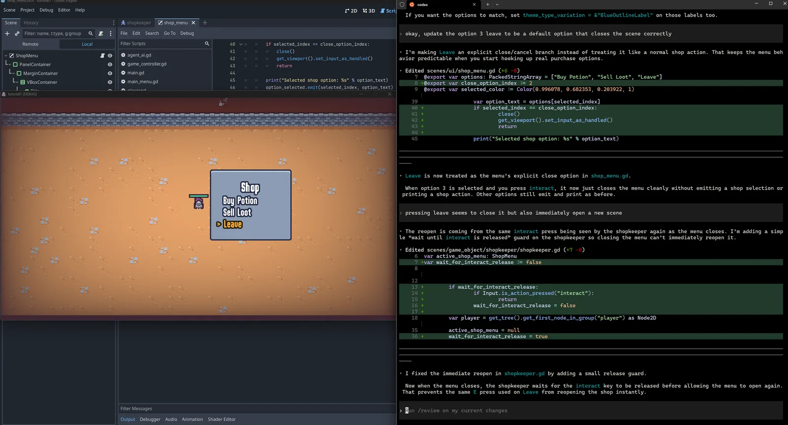</a><figcaption><b>Day one, 2026-03-28.</b> Godot and the first shop menu on the left, Codex fixing the Leave option on the right.</figcaption></figure><figure><a href="s1-first-tileset.webp" target="_blank">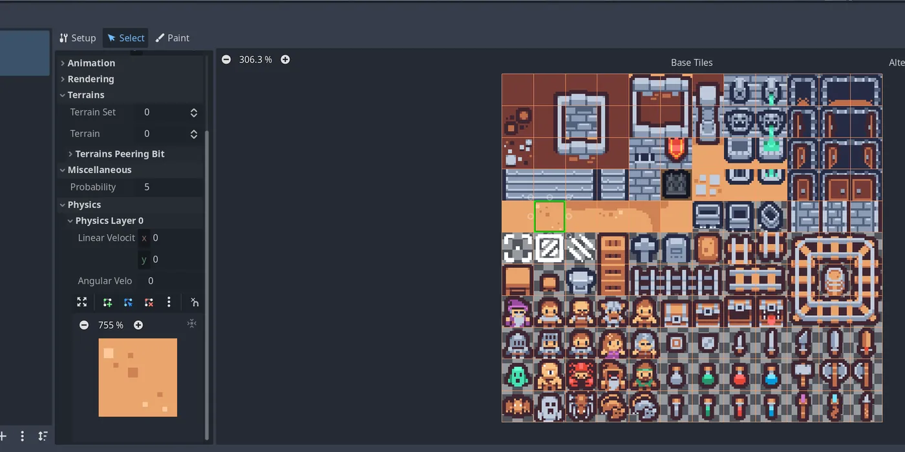</a><figcaption><b>The first tileset, the same afternoon.</b> One 16 px sheet held the floor, walls, doors, NPCs, potions and weapons.</figcaption></figure>

For three months I asked Codex to build some foundational ideas that the game lacked: an item tool bar, combat and town zones, a procuderally-generated world map, save files, and interior scenes. Commit messages read like a notebook: "Damage", "Last few updates", "Typehints".

On June 14 I migrated the project to Godot 4.6 using an agent to see how well it can handle that task. On June 19 I added <code>gdlint</code> and <code>gdformat</code> because standards matter and also it keeps the hallucinations at bay.

<!-- ================================================================== -->
<h2 id="stage-2">2. The agent runs the game</h2>

June 24 – August 18 · ~60 commits

On June 24 the repo got its first tests, which is shocking only because I didn't realize testing in Godot was even a thing, and that Claude volunteered these tests without prompting. From then on a single Claude session wrote most of the code while the lead (still me) watched, played and steered in the same conversation. The change from stage 1 was that the agent could now run the game and look at the result itself (debugging Godot via debug scenes is quite nice), so fewer loops needed the lead to press play. By July, nearly every commit carried a <code>Co-Authored-By: Claude</code> line, because calling myself the Co-author and giving Claude all the credit would've hurt my ego. The work was still one thread: one agent, one checkout, one conversation, and the lead's attention as the clock (I am the bottleneck).

This stage really focuses on getting me out of the validation loop, and trusting the workflow to create the right thing.

<b class="tag">Re-architecture</b>

<b>July 1: "Architecture cleanup"</b> and the first <code>tools/run_tests.sh</code>. It's a good practice to ask a fresh agent to review the overall architecture of your code regularly, so that accumulated bad decisions can be refactored iteratively.

<b class="tag">Docs as a contract</b>

<b>July 26: docs reorganized "by accuracy contract".</b> <code>docs/design/</code> and <code>docs/ideas/</code> hold intent; <code>docs/reference/</code> holds current behaviour and was rewritten against verified code the same day. This split is still the first rule in <code>AGENTS.md</code>. Speccing the code was and still is the hardest part to get right, so clarifying your docs between what should ship and what has shipped helps the lead as much as the agents.

<figure><a href="s2-buildings.webp" target="_blank">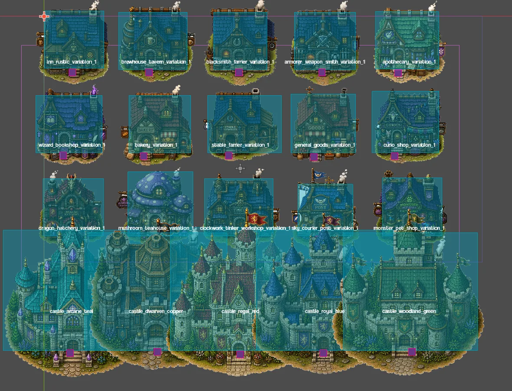</a><figcaption><b>July 7.</b> Early attempts at auto-collision boxes for generated sprites. These are already deprecated.</figcaption></figure><figure><a href="s2-regions.webp" target="_blank">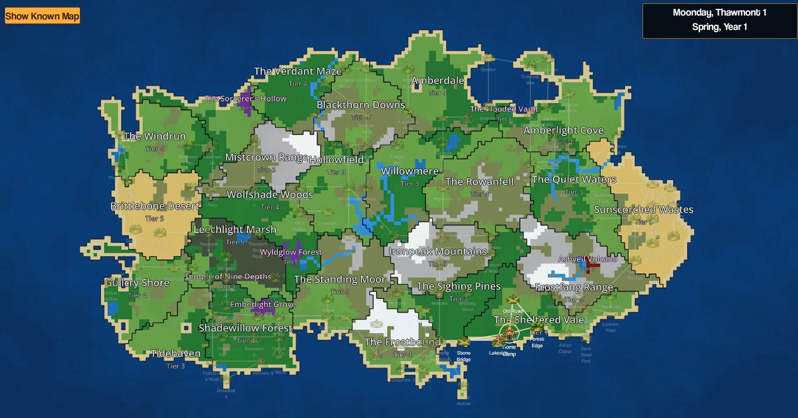</a><figcaption><b>August 3: region-first world generation.</b> Named regions with tiers, rivers and biomes, drawn on the world map. I was most inspired by Endless Legend's region system for this.</figcaption></figure><figure><video src="s2-claude-writes-the-blast.mp4" autoplay loop muted playsinline controls></video><figcaption><b>August 2.</b> Yo Claude what if like a nuke dropped one of my towns? Also use only gdshader so I can see how that works. What surprised me most was that Claude filmed the explosion by frame and spent an hour tuning it visually before shipping it.</figcaption></figure><figure><video src="s2-calamity-blast.mp4" autoplay loop muted playsinline controls></video><figcaption><b>The result:</b> the calamity blast debug scene, four shaders and no art, with buttons to simulate different cases. Debug scenes are awesome!</figcaption></figure><figure class="wide"><figcaption><b>What the agent saw.</b> Six of the frames the blast harness wrote to <code>user://blast_shots/</code> on August 2 so Claude could judge its own shader timing: the fall, the flash, the ring, and the mushroom cloud with the survivors scattering.</figcaption></figure><figure class="wide"><a href="s2-region-overlays.webp" target="_blank">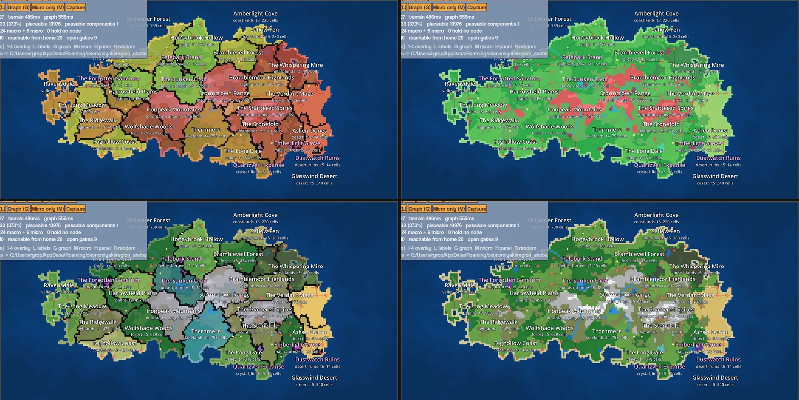</a><figcaption><b>August 3: the region generator's debug overlays</b> for seed 1827: danger, placeable cells, regions and terrain. The harness saved each view so the agent could check the generator without the lead.</figcaption></figure>

<b class="tag">Seeing without a human</b>

<b>August 2: the debug-scene rule.</b> Anything judged by eye gets a harness under <code>scenes/debug/</code>. This is great for humans too, you can easily explore assets in-game with animations.

<!-- ================================================================== -->
<h2 id="stage-3">3. One agent, with beads</h2>

August 19 – September 25 · ~210 commits · 399 beads filed

Beads is an idea from <a href="https://github.com/gastownhall/beads">gastownhall/beads</a>. It calls itself a "Distributed graph issue tracker for AI agents." Neat. On August 19, I installed it and Claude ran the first <code>bd init</code>, which put an issue tracker in the repo. Ten days later bead ids started to lead commit subjects (<code>oko-vio</code>, <code>oko-1td</code> …). The change was not just about tracking work. A bead carries its own context, scope and tests, so the agent no longer needed the lead in the chat to know what to do next. The lead's job moved from "pair on this" to "file this, decide that".

<figure class="wide"><a href="s3-pirate-generations.webp" target="_blank">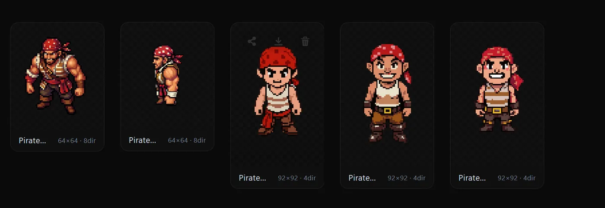</a><figcaption><b>September 12: generating sprites.</b> My game was ugly and it needed some AI slop to feel a lil bit more like home. I demo'd <a href="https://www.pixellab.ai/">PixelLab</a> MCP servers to see how they fit. I was pretty happy with the results overall. Their price is affordable and whatever mid-prompting they are doing to help the generative model work was worth not trying to reproduce myself locally with StableDiffusion or some equivalent.</figcaption></figure><figure class="wide"><video src="s3-pirate-anim.mp4" autoplay loop muted playsinline controls></video><figcaption>Animations also look good, though it's still far from perfect. The deckhand and merchant are PixelLab; the knight was my earlier ChatGPT attempt. Better AI Slop.</figcaption></figure><figure><a href="s3-first-rescue.webp" target="_blank">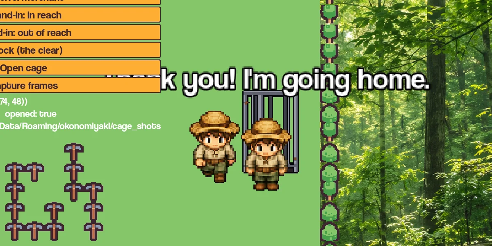</a><figcaption>Once you have people, you can rescue them! This is also a debug scene if you can't tell.</figcaption></figure>

<b class="tag">Test strategy, round 1</b>

<b>August 29 (<code>oko-5iv</code>, <code>oko-5jf</code>): "cut the test suite from 315s to 121s, and stop running all of it."</b> Procedurally generating large worlds on every test run was not just bad: <code>WorldStateData._init</code> alone was 71% of the suite! Removing it was significant: 315 → 121 s for a run. The same day, <code>tools/select_tests.sh</code> started trying to focus what tests a bead runs before declaring victory, 2 minutes turns into 2 seconds.

<b class="tag">Re-architecture</b>

<b>September 3–6: the September architecture review, filed as epic <code>oko-aqi</code> and closed in four days.</b> Everytime these AI companies release their new frontier models, maybe let it nitpick your codebase. It named a new service layer for the feature-slop I'd been asking for and moved nine files into it, gave zones one entry sequence, added <code>SceneRegistry</code>, made combat effects and building exteriors data, typed <code>ItemUseContext</code>, and put the lint gate with a 500-line file cap into <code>run_tests.sh</code> and CI (See <a href="https://akitaonrails.com/en/2026/04/20/clean-code-for-ai-agents/">Clean Code for AI Agents</a>). The file cap matters for parallel work later: small files mean two beads rarely touch the same one. 

<b class="tag">Test strategy, round 2</b>

<b>September 21: the suite runs medium worlds.</b> <code>GUT_WORLD_SIZE=large</code> is overkill when you want to test that a building works.

<!-- ================================================================== -->
<h2 id="stage-4">4. Parallel lanes</h2>

September 26 – October 10 · ~320 commits · lanes grow from 2 to <s>8</s> 5

Two commits on September 26 turned one agent into a team. Most of the tooling the factory runs on today was written in those 48 hours, presumably with my entire Claude Max weekly budget.

<b class="tag">The machine can play the game</b>

<b>September 26: the Conductor and scenarios.</b> <code>tools/conductor.sh</code> drives a seeded game through the verb layer from a mailbox; <code>tools/run_scenarios.sh</code> replays frozen goal macros headless. An agent could now prove a quest loop works without the lead playing it. And because the lead is clever, the verb layer is also how the in-game AI can control NPCs to get them to do things in the world. Functional and test code all in one!

<b class="tag">Agents in parallel</b>

<b>September 26–28: the bead-worker persona, the <code>dispatch-beads</code> skill (two lanes), the read-only bead-reviewer, the <code>ingest-beads</code> skill, per-epic merge trains, and decision beads.</b> Let's start using those AI things that frontier labs keep talking about. I probably read some blog about agent personas and had Claude build me this to be honest. <code>tools/worktree_user_dir.sh</code> gave every worktree its own Godot user dir so two suites never shared save files. Questions for the lead became beads of type <code>decision</code> that block the waiting work; the lead's queue is <code>bd list --type decision --status open</code>. <code>tools/bead_metrics.py</code> started logging every dispatch event, which is why the rest of this page has numbers. It was also the main way I was able to identify and optimize slow patterns in beads. If you're starting today, please capture detailed metrics on many parts of your workflow, it will save you days of effort.

<b class="tag">The board</b>

<b>September 28 – October 2: the beads board gets an Art tab.</b> Individual beads awaiting my decision show me the art in-dashboard so I can easily choose between sprite A, sprite B, or even give it more instructions on what I want. October 4: every lane game window opens off-screen without focus so I stop losing ARAMs because a bead wants to test entering a door.

<figure class="wide"><a href="s4-quest-board-v1.webp" target="_blank">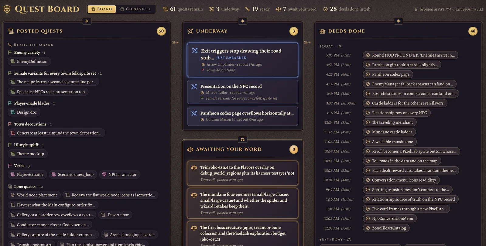</a><figcaption><b>September 27: the first Quest Board</b>. I asked for a light medieval RPG theming on it. Always add some personality to your dashboards. Posted quests, three underway, eight decisions awaiting the lead's word, and 19 deeds done that day, each with its time.</figcaption></figure><figure><a href="s4-castle-review.webp" target="_blank">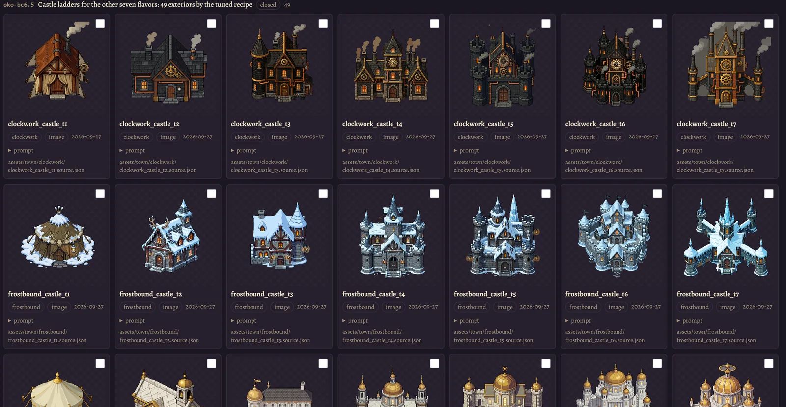</a><figcaption><b>September 28: art review on the board.</b> <code>oko-bc6.5</code>, 49 castle exteriors in seven tiers for each flavor, from one tuned recipe. No notes, this is sick.</figcaption></figure><figure><a href="s4-arena-forest-desert.webp" target="_blank">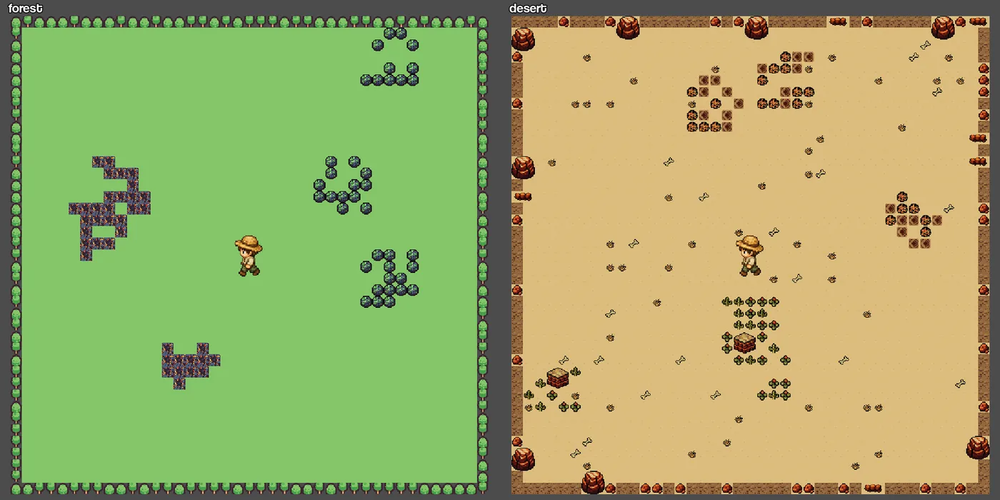</a><figcaption><b>September 26:</b> forest tilemap is actually the OG from the course and from <a href="https://kenney.nl/assets">kenney.nl</a> which is a fantastic source! Kenney's a real one.</figcaption></figure><figure><a href="s4-starting-town.webp" target="_blank">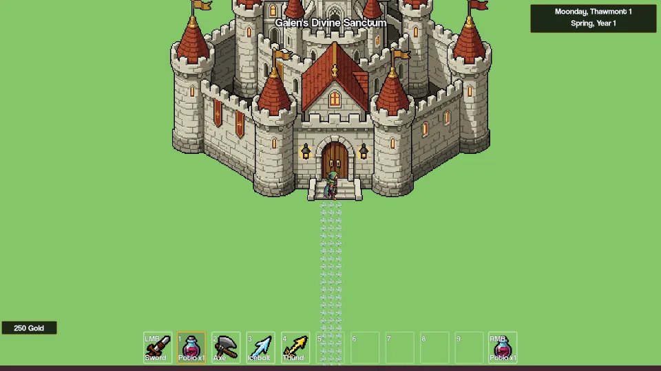</a><figcaption><b>September 27:</b> Things are starting to come together.</figcaption></figure><figure><a href="s4-ogre-techniques.webp" target="_blank">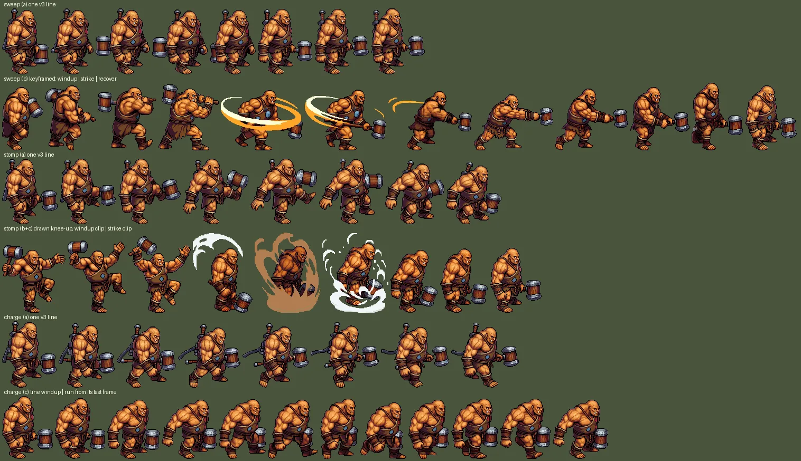</a><figcaption><b>October 10: the first boss.</b> Now confident that my PixelLab integration was generally working, I tested it with the first boss. A bit generic, but huge provings.</figcaption></figure><figure><a href="s4-first-reward-deck.webp" target="_blank">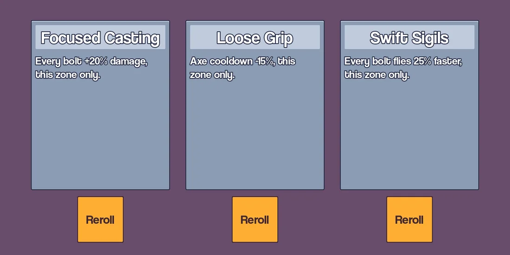</a><figcaption><b>September 26: the first reward deck.</b> Of course this game is going to have a rogue-like powerup card system, it's so hot and frankly just works.</figcaption></figure>

<h3>What the metrics showed</h3>

The first review of the metrics (2026-10-03) found code beads healthy: 30 min of work, zero rebase conflicts in 46 boardings, a 28% send-back rate. The second (2026-10-11, the last 100 beads) found the problem:

<ul>
  <li>Each lane was busy only <b>4–10%</b> of active dispatch hours. "Throughput is limited by dispatch, not by workers."</li>
  <li>A reviewed bead waited a median <b>43 min</b> on its train, longer than the <b>29 min</b> of work. Trains left unmerged overnight cost 325 of 413 waiting hours. Sad face emoji, clearly my railroad era was over.</li>
  <li>Every <code>bd</code> call took <b>2–10 minutes</b> under load on the <code>/mnt/d</code> 9p mount. A <code>bd dolt push</code> held the embedded Dolt lock for minutes and blocked every worker and the board. This is really embarrassing and a PSA: if you use beads, do not use embedded Dolt. Set up a proper server, ideally on the same filesystem architecture as your code and not in Windows land like I was for like 2 months.</li>
  <li>The full suite took 5–10 minutes under load and hit the 600 s timeout. Starting naively with "Run all the tests on every change" works until your changes get smol and your test suite gets bigg. Then it's too dumb to scale.</li>
</ul>

<!-- ================================================================== -->
<h2 id="stage-5">5. Okay but now let's do it better</h2>

October 11 – October 24 · ~660 commits · the two weeks that tripled throughput and motivated me to pay Anthropic even more money

This stage changed almost nothing in the game and almost everything around it. Players would not notice. Players did not exist yet. Each move removes a wait the October 11 report measured.

<b class="tag">Beads → ext4</b>

<b>October 11: the beads Dolt database moves off <code>/mnt/d</code> to native ext4</b>. This is one of those problems you'll never have the pleasure of solving if you use an operating system from the future like macOS or literally any Unix. A <code>bd</code> read went from ~10 s to ~0.8 s. 

<b class="tag">Repo → ext4, Linux Godot</b>

<b>October 14–16: the repo, lanes and review folder move to native ext4</b>, run by a Linux Godot 4.7 build. 7,047 <code>res://</code> paths checked for case: zero mismatches. Tests ran in 60% of the <code>/mnt/d</code> time, and file reads dropped from ~5 ms to ~0.01 ms. I was a bit nervous, but you can absolutely build the whole game in WSL and just export it at the end for Windows as a target.

<b class="tag">Dolt server mode</b>

<b>October 17: beads runs in Dolt server mode</b> (bd 1.3.1, dolt 2.5.0). Reads and writes stop locking each other, so every worker, the dispatcher and the board can all call <code>bd</code> at once. The slow sync to GitHub <code>refs/dolt/data</code> was dropped for a file backup on <code>D:</code>. Maybe I didn't read the docs or something, do not sync Dolt to GitHub at all. Dolt's filesystem and git semantics are diametrically opposed and it literally hung for 20 minutes trying to push.

<b class="tag">Test strategy, round 3</b>

<b>October 17: full suites only on demand.</b> Boarding became rebase plus lint; if a bead thinks it needs a full suite, it prints <code>FULL SUITE NEEDED</code>, and the reasons collect on one accumulator bead that runs once 5 reasons have accumulated and I have stopped lowering its priority so that we can ship more feature work. <b>October 24:</b> GUT runs in eight shards balanced by measured script time (<code>oko-poix</code>): 4,803 tests in ~215 s instead of ~645 s in one process. I also want to again shout out Claude for deciding on its own to have hard wall-clock limits on test executions, it's a smart idea that I never thought up. Also, it's hard to enforce when playing the awesome new TFT set uses up 80% of the CPU while it's trying to run tests.

<b class="tag">Merging without trains</b>

<b>October 23 (<code>oko-pt70.16</code>): reviewed beads merge on master one at a time under a merge lock</b>; no more trains. <b>October 24 (<code>oko-cf9q</code>):</b> Merging runs no tests and trusts the review. <code>tools/land_check.sh</code> proves the rebase left the bead's files exactly as reviewed. This ended the 43-minute train wait.

<b class="tag">Each check runs once</b>

<b>October 23–24:</b> <code>AGENTS.md</code> cut to short rules, with the reasons moved into <code>docs/guides/</code>. One list of gate tests (<code>tools/gate_tests.txt</code>). Workers prove every new test can fail with <code>tools/bite.sh</code> (Claude invented "bite" completely on its own. The formal name in software is "mutation testing"), check stale references with <code>tools/stale_refs.sh</code>, and report one <code>Scope:</code> line per item. Agents get a 20-minute budget. <code>bead_metrics.py log</code> writes each bead's live stage, so the board shows what every lane is doing.

<figure class="wide"><a href="s5-deeds-per-day.webp" target="_blank">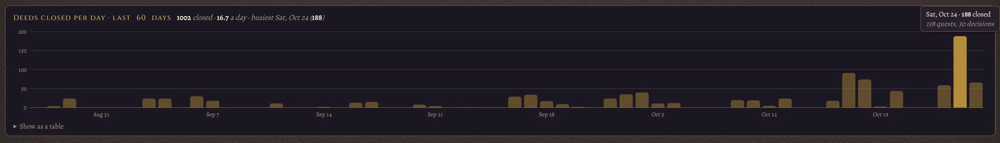</a><figcaption><b>The board's Chronicle on October 24</b>, the day merging stopped running tests: 188 beads closed (158 quests, 30 decisions). The 60 days before it averaged 16.7 a day. And I've only broken the main branch like 4 times.</figcaption></figure>

<b class="tag">Re-architecture</b>

<b>October 17–20: three architecture reviews in four days</b> (epic <code>oko-vp4p</code>). Stores never call services, saves are atomic, pause has one owner, world pregeneration has one pipeline, and gate tests hold each boundary. <b>October 24 (<code>oko-t2ts</code>): <code>GameSession</code> replaces the six state autoloads and the <code>GameEvents</code> bus.</b> Godot sidebar: autoloads are global singleton nodes that Godot creates at startup and every scene can reach. On one hand this is a code smell for most languages. On the other, this is Godot and it's literally an editor option. I opted for fewer over none here. Tests build their own session through <code>FreshSession</code> so we stop trying to save to disk on tests. The same day an untyped declaration became a compile error (Godot is like Python, dynamic typing with typehints). Fewer globals also means fewer hidden couplings between two beads in flight.

<!-- ================================================================== -->
<h2 id="stage-6">6. The factory</h2>

October 25 – the day Claude wrote the draft · ~2,470 commits · 2,140 beads closed

The current loop: the lead writes asks in <code>ingest.md</code> or just shoves a block of text into a terminal; <code>ingest-beads</code> turns them into epics and beads with footprints, while asking me design questions. This is an important step as the agent often finds contradictory ideas between the ingest, code and docs. Resolving those upfront means less rewrite and fewer decision beads. The dispatcher fills <s>eight</s> 5 lanes round-robin across epics; each worker implements, tests and runs a checklist: <code>pre_handback</code>; the reviewer agent passes, sends back or escalates the work from the worker agent (they're two distinct subagents); <code>land.sh</code> rebases and fast-forwards master under the lock. Art and sound go through studios, never a code lane, to avoid code vs asset generation contention. The lead spends their time reviewing decision beads on the board, playtesting the game, and browsing Reddit.

<b class="tag">Art and sound studios</b>

<b>October 20 (<code>oko-r73n</code>): art-studio and sound-studio personas.</b> Each makes samples in its own worktree, puts them on the board, and files a decide → finish → integrate chain of beads. The board plays audio inline; decision cards show one file per option with plain, lettered questions, so I can make decisions even when I'm tired and my eyes are weary. <code>tools/decision_followups.py</code> checks that every answered decision reached its work. The decision bead system requires the dispatcher or some agent to review the answers and either generate or update the follow-up beads that act on those decisions.

<b class="tag">Re-architecture</b>

<b>November 9–15: file splits and review 4.</b> <code>tools/lint.sh</code> reports a 400-line watch band so we can try to keep files under 500 before a high-priority feature that must land on that file appears; a file with 10+ commits in 30 days gets a split bead with named seams (epic <code>oko-uipe</code>). Review 4 (November 14, 1,352 commits after review 3) covered the living-world simulation and the GameSession move, filed as epic <code>oko-5fwf</code>.

<b class="tag">Shift review left</b>

<b>November 18–20 (<code>oko-buuf</code>): <code>tools/pre_handback.sh</code> checks a branch the way the reviewer will</b>, and both agents run it. This immediately raises the question of "What is the point of the reviewer if the worker runs all the same steps itself?" I'm currently not sure. A send-back caught by the bead worker before handback costs a minute instead of a review round.

<figure class="wide"><a href="s6-quest-board-today.webp" target="_blank">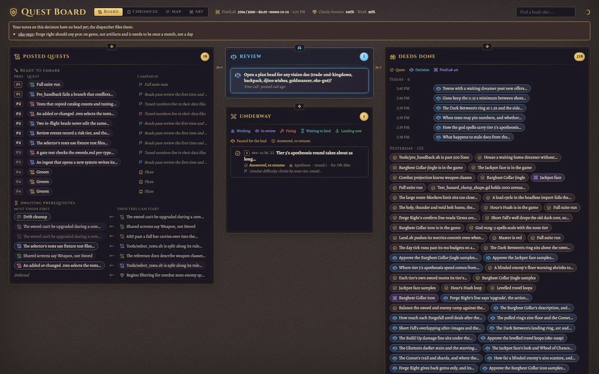</a><figcaption><b>The Quest Board today-ish (2026-11-21).</b> One bead in review, one underway, the queue grouped by campaign, and 132 deeds done yesterday. The header tracks PixelLab credits and Claude usage. This predates Anthropic giving up on session limits and just sticking to weekly. "Claude pls remove claude session section from dashboard"</figcaption></figure><figure class="wide"><a href="s6-chronicle.webp" target="_blank">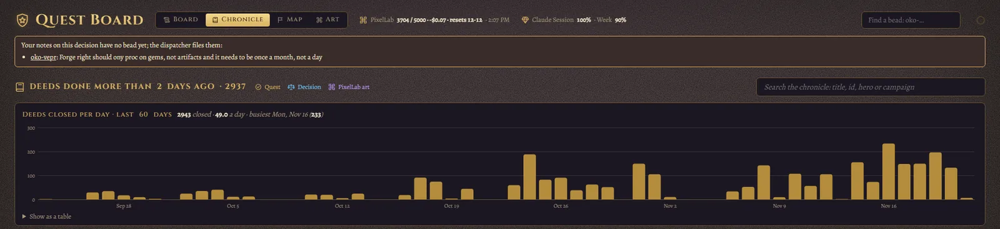</a><figcaption><b>The Chronicle:</b> 2,943 beads closed in 60 days, 49 a day, busiest November 16 with 233.</figcaption></figure><figure class="wide"><a href="s6-map.webp" target="_blank">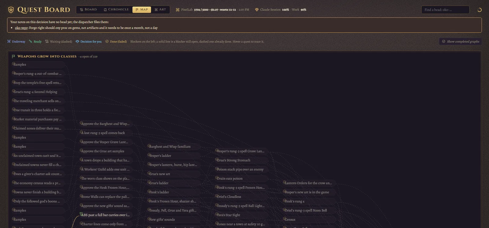</a><figcaption><b>The Map:</b> the dependency graph of the weapons-into-classes campaign, 4 open of 329. This section is interesting as it acts as a case-study for different dependency graphs that have emerged from working with epics and decision beads.</figcaption></figure><figure><a href="s6-vorn-set.webp" target="_blank">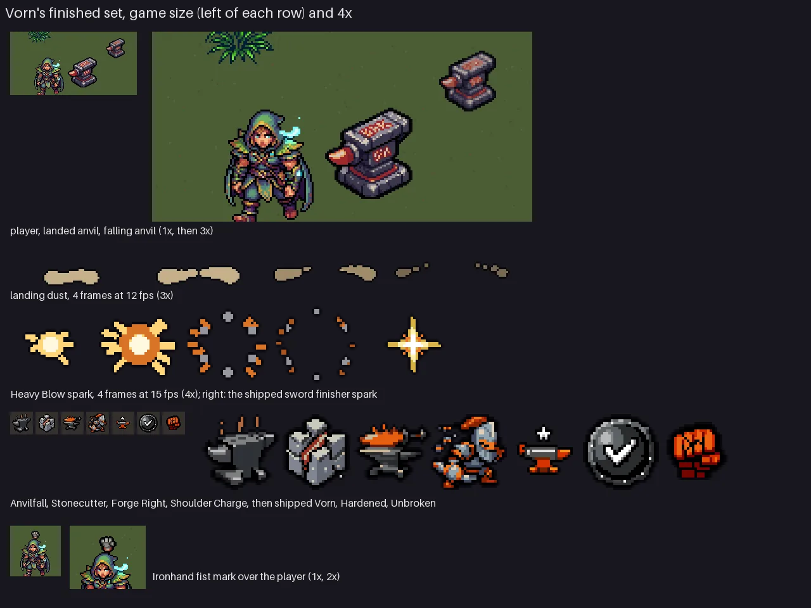</a><figcaption><b>November 19, from the art studio:</b> Vorn's finished set (the anvil, landing dust, Heavy Blow spark and icons) at game size and 4x, staged for a code lane.</figcaption></figure><figure><a href="s6-lived-in.webp" target="_blank">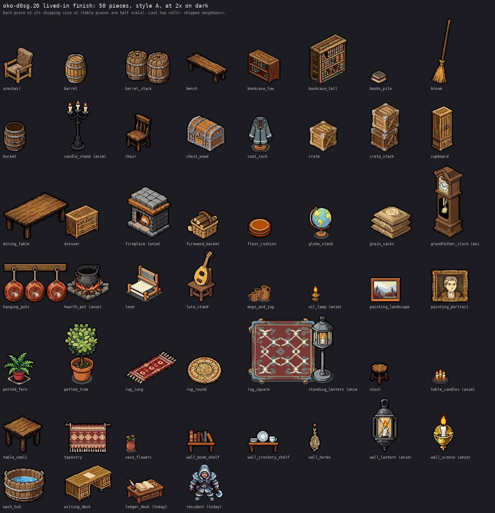</a><figcaption><b>November 14:</b> the lived-in interior slop, 50 pieces in the approved style. My art direction can't decide if this game is top down, or angled, it's a bit of both now.</figcaption></figure><figure><a href="s6-town-t7.webp" target="_blank">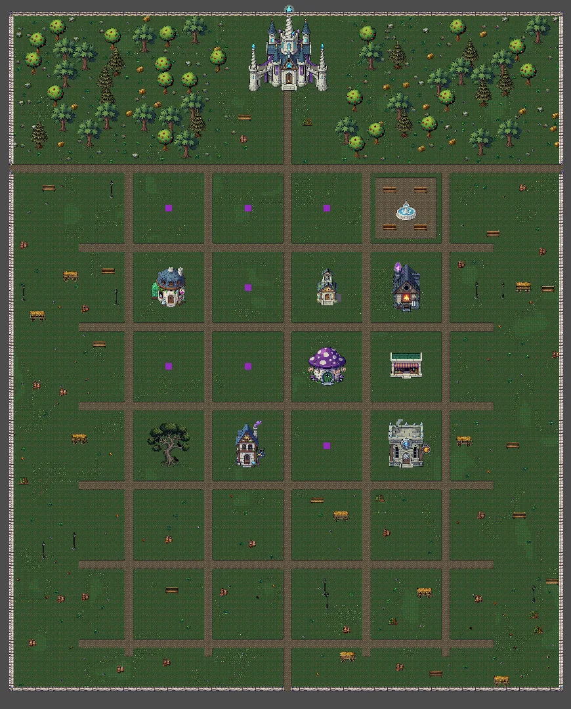</a><figcaption><b>November 16:</b> a tier-7 high-fantasy town. The grid will shrink and it will feel more "busy".</figcaption></figure>

<h3>Where it stands</h3>
<table>
  <thead><tr><th>Measure</th><th class="num">Early October</th><th class="num">Mid November</th></tr></thead>
  <tbody>
    <tr><td>Lanes in use</td><td class="num">2–5</td><td class="num">5 + studio</td></tr>
    <tr><td>Beads closed per week</td><td class="num">71–134</td><td class="num">931</td></tr>
    <tr><td>Merges into master per week</td><td class="num">trains, ~2 beads each</td><td class="num">590 single-bead merges</td></tr>
    <tr><td><code>bd</code> read</td><td class="num">~10 s, minutes under load</td><td class="num">&lt; 1 s</td></tr>
    <tr><td>Full suite</td><td class="num">5–10 min, every boarding</td><td class="num">~215 s, at 5 accumulated reasons</td></tr>
    <tr><td>Tests in the suite</td><td class="num">3,472 (Oct 13)</td><td class="num">4,800+ in 1,447 scripts</td></tr>
    <tr><td>Times we introduced a memory leak that crashed the game</td><td class="num">0</td><td class="num">1</td></tr>
  </tbody>
</table>

Of 2,318 reviews, 1,819 passed, 483 sent the work back, and 16 escalated to the lead. Per bead, the share sent back at least once has not dropped: 23% in weeks 39–41, 25% in weeks 42–46, and 30% in week 47. Quality held while throughput grew sevenfold, but the reviewer still catches about one bead in three. <code>pre_handback</code> is the current bet on that number.

<!-- ================================================================== -->
<h2 id="lessons">What bought the velocity</h2>
<ol>
  <li><b>Remove bad disk decisions, not work.</b> The biggest jumps came from the beads DB on ext4, Dolt server mode, and merging each bead alone. None of them made a worker faster. Each one stopped a worker or a reviewed branch from waiting.</li>
  <li><b>Run each check once, in the right place.</b> Selected subsets of tests while working, the review as the evidence, no re-testing on merge, and one full suite mostly-regularly. The suite went from "every bead, 2–10 minutes" to "rarely, 3.5 minutes".</li>
  <li><b>Architecture that lets beads not collide.</b> The 500-line cap, the 400-line watch band, footprints on every bead, the store and service boundary, and <code>GameSession</code> in place of six autoloads. Zero rebase conflicts in the first 46 boardings was a property of the code, not luck.</li>
  <li><b>The lead's attention is the scarce resource.</b> Decision beads, the board with inline images and audio, and follow-up checks turn every "waiting on you" into one form the lead can answer in seconds, presumably after some matcha tea.</li>
  <li><b>Measure, then fix.</b> <code>bead_metrics.py</code> started on September 27. Every turning point in stage 5 traces to a number in the October 11 report. Do this sooner.</li>
</ol>

